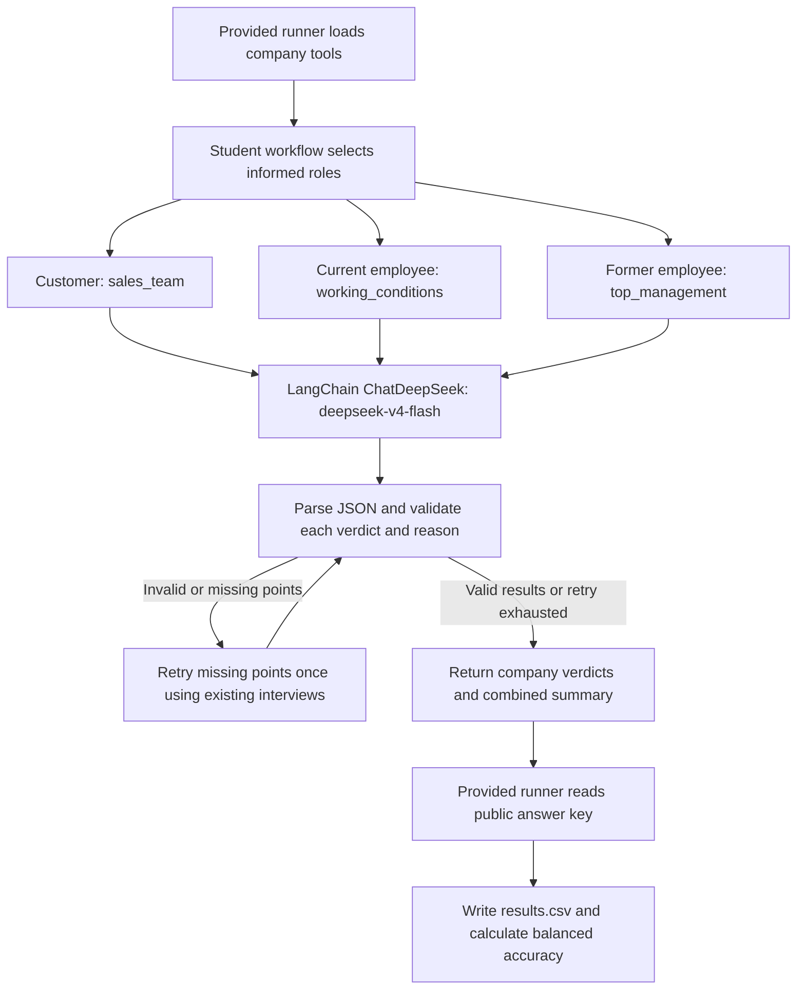

# FTEC5660 Homework 3: Fisher's 15-Point Investment Agent

Build a LangChain agent that researches a company with tools and applies the
framework from Philip Fisher's *Common Stocks and Uncommon Profits* (Part One,
Chapter 3 "What to buy: the fifteen points to look for in a common stock", and
Chapter 4 "What to buy: applying this to your own needs"). You choose 3 of
Fisher's 15 points and decide yourself what PASS means for each. For every
company your agent gives a PASS/FAIL verdict on your 3 points and a short
summary.

The companies are fictional, so the model cannot answer from memory. Unlike a
pile of reports, the evidence is spread over three sources, and your agent has
to go and get it with tools, the way Fisher's "scuttlebutt" method sends an
investor to talk to customers, competitors, suppliers and staff.

## Data and tools

`public_test/` has one folder per company. Your code receives four tools per
company (built by the provided code in `hw3.py`):

| Tool | What it gives you |
| --- | --- |
| `list_documents()` | the company's six documents and their dates |
| `read_document(name)` | one document: the 2025 letter to shareholders, four earnings calls (Q3 2025 to Q2 2026) and a news file (July 2025 to July 2026) |
| `sql_query(query)` | one read-only SQLite query on the company's database; at most 50 rows come back, so use `SUM`, `GROUP BY` and `WHERE` |
| `interview(role, topic)` | what one person says about the company; at most **10 interviews per company** |

The documents are what management says. Management's own claims (such as "we
have never cut research" or "our people are our greatest strength") are not
evidence on their own: check them against the database and the interviews.

**Database tables** (amounts in USD thousands; dates `YYYY-MM-DD`, months
`YYYY-MM`, quarters like `2025Q3`; the fiscal year is the calendar year):

| Table | Columns |
| --- | --- |
| `company` | name, industry |
| `industry_medians` | industry, revenue_growth_2y_pct, new_product_share_pct, new_product_sales_per_rd, operating_margin_pct (one row per industry; use the row for the company's own industry) |
| `orders` | order_id, order_date, product, customer, amount, note (about 3,000 to 4,000 orders from January 2023 to June 2026; revenue is the sum of order amounts) |
| `products` | product, launch_date |
| `monthly_costs` | month, cost_of_sales, selling_admin, research_development |
| `quarterly_cash` | quarter, operating_cash_flow, capex, cash_end |
| `capex_plan` | year, planned_capex (2026 to 2028) |
| `returns` | month, units_shipped, units_returned |
| `insider_trades` | trade_date, person, title, side (`buy` or `sell`), shares, price |

**Terms used in the data.**

| Term | Meaning |
| --- | --- |
| FY2025 | Fiscal year 2025. Here the fiscal year is the calendar year, so FY2025 is January to December 2025. |
| Quarter | Three months of the year: Q1 is January to March, Q2 April to June, Q3 July to September and Q4 October to December. The database writes `2025Q3`; the documents write "third quarter 2025". |
| Amounts | The database is in **USD thousands** (676,100 means US$676.1 million). The documents use USD millions. |
| Revenue | Money from sales: the sum of `amount` in `orders`. |
| Cost of sales | The cost of making the products that were sold. |
| Selling and admin | The cost of selling and of running the company (sales staff, offices, management). |
| R&D | Research and development spending, mainly on new products. |
| Operating margin | Operating profit as a share of revenue: (revenue − cost of sales − selling and admin − R&D) ÷ revenue. |
| Operating cash flow | Cash that the day-to-day business brings in during a quarter. |
| Cash at the end of a quarter | The cash the company holds on the last day of that quarter (`cash_end`). |
| Capex | Capital expenditure: spending on factories, machines and other long-term assets. `capex_plan` holds the planned capex for 2026 to 2028. |
| Return rate | Units returned ÷ units shipped, from the `returns` table. |
| Industry median | The middle value for companies in the same industry, from `industry_medians`. |
| Insider | A director or senior manager of the company. `insider_trades` lists the shares they bought (`buy`) or sold (`sell`). |
| Earnings call | A meeting each quarter where management presents the quarter's results to investors. Each call quotes that quarter's revenue. |

**Interviews.** Roles: `customer`, `current_employee`, `former_employee`,
`competitor`, `supplier`. Topics: `sales_team`, `working_conditions`,
`top_management`, `decision_making`, `competitive_edge`. Only some people know
about each topic; the others say they can't comment, and that answer still
uses up one interview.

| Topic | Who knows about it |
| --- | --- |
| `sales_team` | customer, competitor |
| `working_conditions` | current_employee, former_employee |
| `top_management` | former_employee, supplier |
| `decision_making` | supplier, customer |
| `competitive_edge` | competitor, customer |

People who know about a topic always agree with each other, so one good answer
is enough.

## Choose your 3 points and your rules

Pick any 3 of Fisher's 15 points and write them in `CHOSEN_POINTS` near the
top of `hw3.py`, e.g. `CHOSEN_POINTS = [1, 7, 15]`. The full questions are in
`FISHER_POINTS` in `hw3.py` and in the book.

| # | Fisher's point | Where the evidence is |
| --- | --- | --- |
| 1 | Market potential for sales growth | database |
| 2 | New products as current lines mature | database |
| 3 | Effective research and development | database |
| 4 | Above-average sales organization | interviews (`sales_team`) |
| 5 | Worthwhile profit margin | database |
| 6 | Maintaining or improving margins | database |
| 7 | Labour and personnel relations | interviews (`working_conditions`) |
| 8 | Executive relations | interviews (`top_management`) |
| 9 | Depth of management | interviews (`decision_making`) |
| 10 | Cost analysis and accounting controls | earnings calls, checked against the database |
| 11 | Advantage over competitors | interviews (`competitive_edge`) |
| 12 | Long-range outlook on profits | database |
| 13 | Growth without dilutive equity financing | database |
| 14 | Management talks freely about troubles | earnings calls, checked against the database |
| 15 | Management of unquestionable integrity | news file, checked against the database |

For each of your points, **you design the rule**: which evidence to use, what
to compute or whom to ask, and where the line between PASS and FAIL lies. PASS
means the company looks favourable on that point, as Fisher would see it.

We grade your verdicts against our own answer key. It uses one fixed rule per
point, which we do not publish, and the data never puts a company close to
the line of that rule, so a sensible reading of Fisher usually gives the same
answer. **Test your rules on the public answers**:
`public_test/ground_truth.json` gives the expected verdict on all 15 points
for each of the 20 public companies, and every point fails in 6 of them. If
your rule disagrees with the public answers, rethink it.

**Tip: calculate with tools, not in your head.** Do every sum, ratio and
comparison in SQL or Python, including the number of days between two dates
(SQLite's `julianday()` gives a date as a number of days).

## Student task

Fill in the three places in `hw3.py` marked `### YOUR CODE HERE`. You may add
imports, constants and helper functions above them, but do not change the
provided code below them:

- `CHOSEN_POINTS` lists your 3 points.
- `build_agent()` creates your model and anything else you need once.
- `analyze_companies(agent, companies)` receives
  `{company_folder: [list_documents, read_document, sql_query, interview]}`
  and returns, for every company,
  `{"points": {1: "PASS", 7: "FAIL", 15: "PASS"}, "summary": "..."}` (here with
  `CHOSEN_POINTS = [1, 7, 15]`).

Use the course techniques that fit your points: tool use for the database and
the interviews, planning which interviews to spend, routing each point to the
right source, prompt chaining, parallel calls, reflection to check your
answers, or a combination. Your code must read company data **only through
the four tools**; do not open `company.db` or `interviews.dat` yourself. Do
not hard-code folder names, company names or the public answers.

## Setup and public test

```bash
python3 -m venv .venv
source .venv/bin/activate
pip install -r requirements.txt
echo "DEEPSEEK_API_KEY=your_key_here" > .env
python3 hw3.py --data-folder public_test
```

Use your own DeepSeek API key (from https://platform.deepseek.com). The
required model is `deepseek-v4-flash`. We grade with our own key, so never put
a key in your code; `.env` must stay out of git.

The program creates `results.csv` with the columns `company`, `points`,
`points_correct`, `point_errors`, `interviews_used` and `summary`, and prints
the point score on your 3 points (the percentage after "balanced"). The point
score is the average of two shares: the share of truly passing verdicts that
you marked PASS and the share of truly failing verdicts that you marked FAIL.
For example, 90% and 60% give (90% + 60%) / 2 = 75%, and marking every point
PASS gives (100% + 0%) / 2 = 50%. Once `CHOSEN_POINTS` is set, the starter
runs before you add any API code (it returns no verdicts, so it scores 0%).

`public_test/ground_truth.json` gives the expected verdicts on all 15 points
for each public company. Grading uses a private set of about 20 unseen
companies with the same tools and the same answer key rules, but different
names and wording, and scores your 3 points only.

## Homework 3 solution

### My three points and rules

I selected points **4, 7 and 8** because the supplied interviews directly describe sales service, employee experience and executive cooperation. These topics also demonstrate Fisher's scuttlebutt approach: asking people with relevant experience. The assignment states that knowledgeable respondents agree, so one appropriate respondent per topic is sufficient in this dataset.

| Point | Why selected and evidence | PASS rule |
| --- | --- | --- |
| 4 — Above-average sales organization | Ask a customer about `sales_team`: customer satisfaction and repeat business, relative sales effectiveness, active solicitation, service and delivery, personnel selection/training, and continuing improvements in sales, advertising and distribution. | PASS when the concrete evidence as a whole supports an above-average sales organization. Weigh negative evidence about effectiveness in context; product success or training alone does not establish PASS. |
| 7 — Outstanding labor and personnel relations | Ask a current employee about `working_conditions`: fair treatment, morale, local turnover/pay comparisons, grievance handling, applicant interest, and management's responsibility toward ordinary workers. | PASS when the composite evidence supports outstanding labor and personnel relations. Weigh adverse treatment and unresolved problems in context rather than applying a single numerical yardstick. |
| 8 — Outstanding executive relations | Ask a former employee about `top_management`: trust in leadership, teamwork, ability-based advancement, internal promotion, regular and competitive compensation, and management's handling of non-cooperation. | PASS when the overall evidence supports outstanding executive relations and the retention and effective work of able executives. Weigh factionalism, unfair advancement and destructive friction in context rather than treating all disagreement as negative. |

All dimensions are assessed when supported by evidence; none is silently assumed or made an individual mandatory condition. For point 4, aggressive distribution means active, effective selling and distribution, not a required channel count or geographic footprint. For point 7, high profits together with above-average local wages are a positive clue; profits substantially dependent on below-standard local wages are a warning. Applicant queues require the context of no local labor surplus. Management's disregard for workers, including mass hiring/dismissal over slight business changes, is negative evidence. Unionization alone is not negative, absence of strikes can reflect fear, and Fisher's observation about companies without an outside union is conditional on a widely unionized setting where organizing would otherwise be expected.

For point 8, above-entry-level vacancies should favor capable internal candidates: bypassing an available internal candidate who could fill the role to hire an outsider is negative; external hiring when no internal candidate could be promoted is not negative on this factor. If internal candidates are unknown, external hiring alone does not settle the verdict. Family membership alone is not negative; advancement over more able people is. Normal friction can occur, but management should not tolerate refusal to cooperate. Salary reviews and pay relative to both industry and locality are considered when mentioned.

Unmentioned factors remain unknown, and one unknown factor does not force an overall FAIL. Evidence is assessed for severity, persistence, context and resolution, with no invented weights or fixed numerical cutoffs. If the evidence for an entire point is insufficient to support PASS, the required binary result is FAIL with an explicit evidence limitation; this fallback is an assignment convention, not Fisher's own rule.

Only the interview tool is used because Section 3.3 assigns all three selected points to interviews and states that informed respondents agree. Documents and SQL are available but are not required to answer these selected topics; they would not automatically provide independent evidence about interpersonal behavior.

These are operational rules derived from Fisher's discussion. Interviews may omit compensation, promotion policies or training, so a verdict is limited to the supplied evidence. It does not establish every aspect of a real company's organizational quality.

### Design



The workflow plans three interviews per company and invokes the provided LangChain interview tool with the appropriate role and topic. One model request normally evaluates all three interviews together under the Fisher-based prompt. Up to five companies are processed concurrently. The model returns JSON containing three verdicts and evidence-based reasons; each valid point is retained, and missing or invalid points receive one additional application-level attempt without repeating interviews. API calls have a 60-second request timeout and one client retry. Persistent model failures are recorded in the summary and unresolved points remain missing, which the provided scorer correctly treats as wrong. An outer per-company exception handler also preserves a record for unexpected ordinary errors, so another company can continue. Explicit task cancellation is allowed to propagate. Verdict strings are stripped of surrounding whitespace and normalized to uppercase before validation. The model receives interview evidence and rules; the public answer key is loaded by the provided runner after analysis.

### Public results

On 19 November 2026, the student ran the expanded Fisher prompt locally and supplied the resulting results.csv. Rechecking all 60 verdicts against public_test/ground_truth.json confirmed **60/60 correct and 100.0% balanced accuracy**, with all 20 companies present, three interviews per company, no missing verdicts and an explanatory summary for every company. The CSV does not record elapsed time or a source-code hash, so no runtime is attributed to this new run; its association with the expanded prompt follows the student's reported execution. This is a public-sample result, not a private-test guarantee.

An earlier version was separately cloned from the published GitHub fork and ran successfully in 12.5 seconds. That timing and fresh-clone check belong to the earlier version, not this expanded prompt.

| Point | Correct / total | True PASS correctly identified | True FAIL correctly identified |
| --- | --- | --- | --- |
| 4 | 20/20 | 14/14 | 6/6 |
| 7 | 20/20 | 14/14 | 6/6 |
| 8 | 20/20 | 14/14 | 6/6 |
| Total | 60/60 | 42/42 | 18/18 |

Balanced accuracy = 0.5 × (42/42 + 18/18) = **100%**. There are **no companies whose final verdicts disagree with the public answers**, so there is no final-run disagreement list to explain.

Earlier development considered points 1, 2 and 5. The model struggled to distinguish future growth potential from historical product sales, and ongoing development from repeated sales of previously launched products. I changed the selected points after reviewing Fisher and the available evidence. Interview topics align more directly with points 4, 7 and 8. The final workflow uses semantic interpretation rather than company-specific answers or exact phrase matching. Public-test success still leaves uncertainty about new wording, mixed evidence and API failures.

### How the rules were refined

The expanded prompt retains the earlier evidence dimensions: sales knowledge, advice, proactive service and problem solving; fair treatment, morale, retention and grievance handling; executive trust, cooperation, fair advancement and compensation. Examples such as merely sending price lists, persistent low morale, unresolved grievances and refusal to communicate remain covered by these dimensions rather than becoming keyword triggers. Product success alone still does not establish sales excellence; overtime and mixed evidence still require context; unmentioned factors remain unknown.

The revision adds Fisher's discussion of active distribution, personnel selection and continuing training, local labor comparisons, management's responsibility toward workers, regular executive salary reviews and preference for capable internal candidates. The earlier shorthand about external recruitment is replaced with its explicit conditions. The earlier phrase requiring no unresolved serious negative evidence is replaced by an overall assessment of severity, persistence, context and resolution; serious adverse evidence remains relevant, without turning an isolated factor into an automatic veto. No factor is assigned an invented weight or mandatory tier. Unknown evidence about one factor is distinguished from insufficient evidence for an entire point.

### Reproduction and reference

Use Python 3.10 or later and install `requirements.txt` in a virtual environment. Set `DEEPSEEK_API_KEY` in the environment or a local `.env` file. This implementation also accepts the local name `HW3`, which takes precedence if both are present.

```bash
python3 -m venv .venv
source .venv/bin/activate
pip install -r requirements.txt
python3 hw3.py --data-folder public_test
```

The script writes `results.csv` in its working directory. Keep credentials in the environment or ignored `.env` file. All company evidence is accessed through the provided tools. The provided tools, runner and scoring functions retain their original code.

Reference: Philip A. Fisher, *Common Stocks and Uncommon Profits*, Part One, Chapter 3, points 4, 7 and 8, printed pp. 59–62 and 65–68 (PDF pages 85–88 and 91–94), checked directly in the supplied scanned edition. The descriptions above are paraphrases, not verbatim quotations.

Task 2 is included in [REFLECTION.md](REFLECTION.md).
